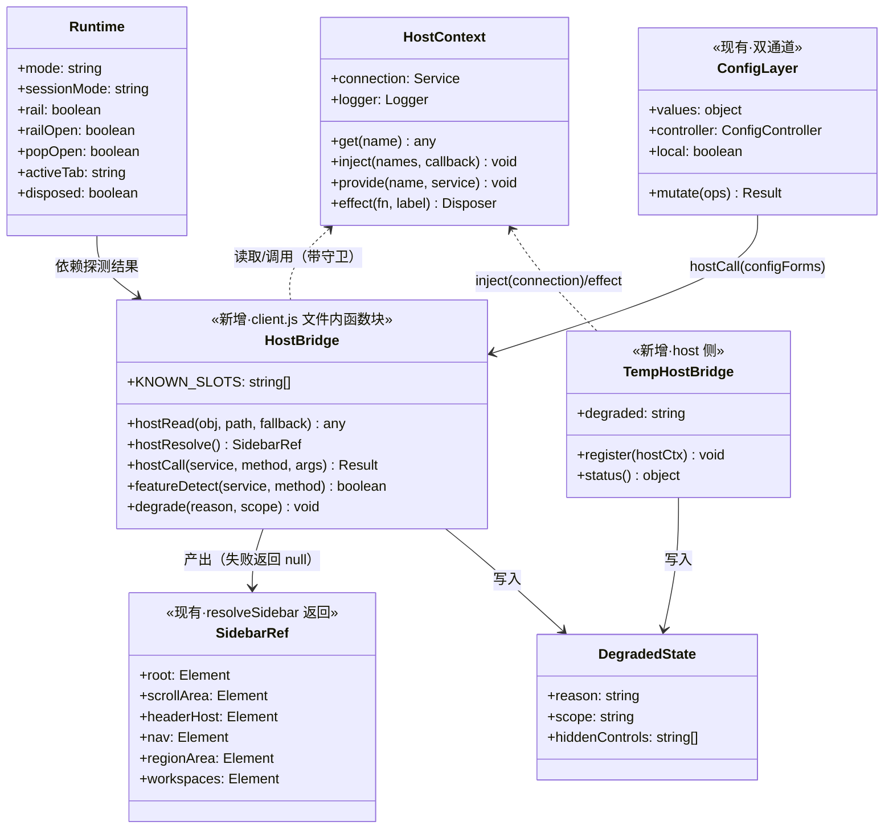
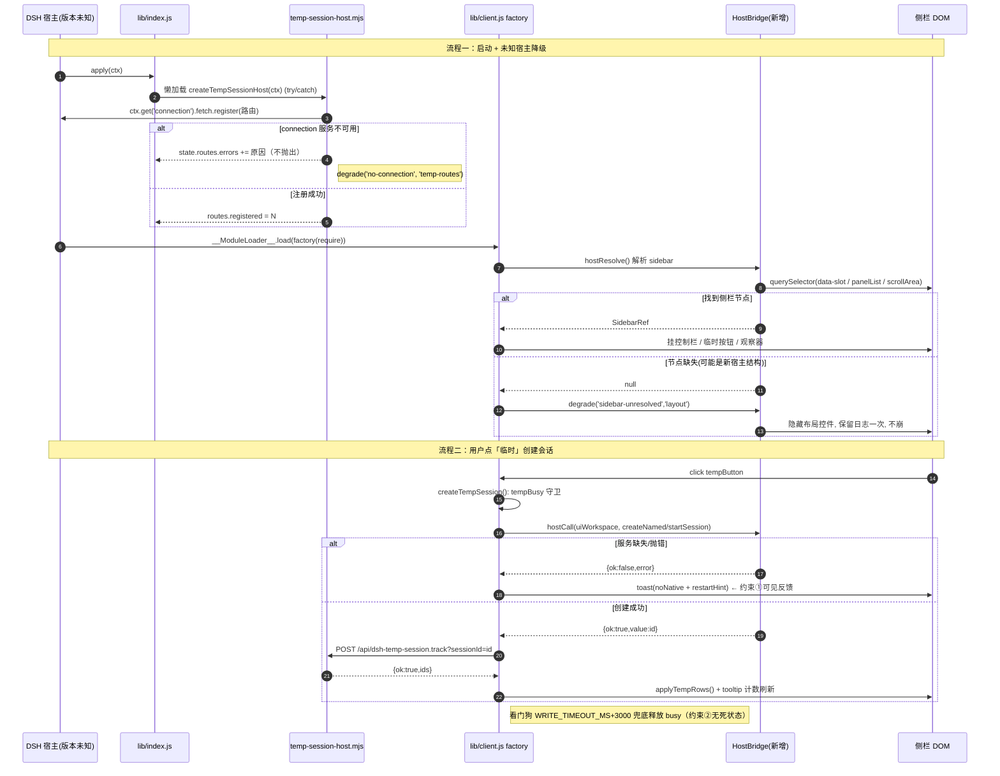
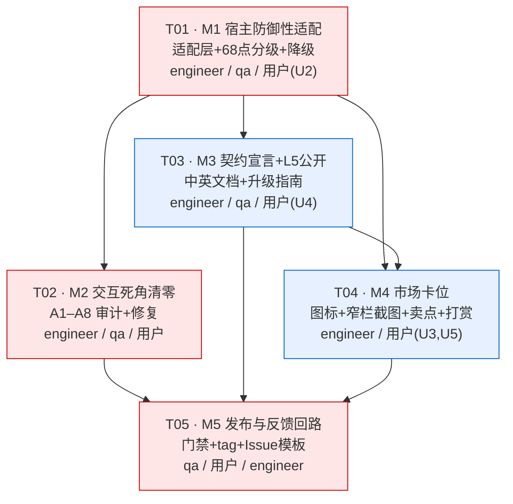

# dsh-sidebar-suite 1.0.0「稳态契约版」架构设计与任务分解

> 作者：高见远（架构师）　版本：设计稿 v1　日期：2026-11-24
> 依据：PM（Alice）已出方案并获用户确认的 5 里程碑；用户对 M1 的拍板原话见 §6.0。
> 本文只做**设计与文档**，不含实现代码；不修改 `lib/` 下源文件，不发布。行号均基于 **0.8.11**，改动时会漂移，定位以函数名/注释锚点为准。

---

## 0. 文档导读（写给非程序员）

这个插件现在很稳定（0.8.11，39 个测试文件 1241 项全绿）。下一个大版本定为 **1.0.0 稳态契约版**，意思是：**不加新功能，把"稳"这件事做实、说清、卖出去**。

五个里程碑用大白话说就是：

| 里程碑 | 一句话目标 | 你（用户）能看到的交付 |
| --- | --- | --- |
| M1 宿主防御性适配 | 提前为"未来某天 DSH 升到 0.3.0"打预防针：认不出的新宿主来了，插件优雅退让而不是把界面搞崩 | 插件在新旧宿主上都不崩；`engines.dsh` 声明**这次不动**（0.3 还不放行） |
| M2 交互死角清零 | 按你定的"交互五条军规"把三种布局、临时会话、设置页挨个查一遍，找出"点了没反应/被困住"的死角 | 一份逐条核对的审计清单 + 确认后的修复 |
| M3 契约宣言 | 用中英双语白纸黑字承诺"哪些东西 1.x 不会乱改"，把 L5 矩阵公开 | 契约宣言文档、升级指南、API 稳定性承诺 |
| M4 市场卡位 | 让插件在市场里"一眼看懂、想点进来" | 新图标、带窄栏的截图、一句话卖点、打赏合规说明 |
| M5 发布与反馈回路 | 打 tag 发版，并把"用户怎么提需求/反馈"的路铺好 | `v1.0.0` tag、反馈引导、Issue 需求征集模板 |

**本轮明确不做**：写实现代码、改 `lib/` 源文件、发版、放行 0.3.0。

---

# Part A　系统设计

## 1. 实现方式（Implementation Approach）

### 1.1 技术现状与约束

本项目**不是**新建的 React/MUI 应用，而是已有的**原生 JavaScript 插件**，三段代码各有运行环境，设计必须顺着它走，不能强套默认技术栈：

| 文件 | 运行环境 | 模块形态 | 含义 |
| --- | --- | --- | --- |
| `lib/client.js`（6110 行） | 浏览器页面（DSH 客户端 UI） | `window.__ModuleLoader__.load({ factory(require) {...} })` 的**自包含浏览器包**，在 VM 中求值 | 不能 `import` 一个新写的 `.mjs` 适配文件给客户端用；适配逻辑必须以**文件内辅助函数**形式加在 client.js 内部 |
| `lib/index.js`（222 行） | DSH 主进程（Node） | 真正的 ES Module（顶层 `await import`） | 这里可以安全地做动态加载与降级（现有 `tryBare`/`loadSchema`/懒加载 temp host 已是范例） |
| `lib/temp-session-host.mjs`（2457 行） | DSH 主进程（Node） | ES Module | `/api` 路由注册、`ctx.effect` 定时器，宿主服务缺失时要有兜底 |

> **关键设计结论 ①**：M1 的"适配层"在 client.js 侧必须做成**文件内的内聚函数块**（扩展现有的 `safeGet`、`resolveSidebar`），而不是新建被 import 的模块——否则会因模块加载器拿不到而整包加载失败。这是由代码现状决定的，不是偷懒。

### 1.2 核心难点

1. **没有真实的 0.3.0 可对照**（已核实：本机与官方 releases 最新均为 `0.2.3-alpha.2`，无任何 0.3 预览）。所以 M1 只能是**防御性设计**：不针对某个具体的新 DOM 去改，而是梳理"我们对宿主做了哪些硬假设"，把每个假设变成"先探测、再使用、失败有退路"。
2. **测试铁律不可破**：先红后绿 + 变异对照；39 文件 1241 项全绿；契约矩阵 54/54；`npm test` 是唯一入口。任何适配改动都要能"人为撤掉→测试变红"，否则视为没测到。
3. **交互五约束是验收标准**（M2）：①点了有可见反馈 ②无死状态 ③互斥语义统一 ④窄栏只剩图标可分辨 ⑤不与已有入口重复；且"宁可砍功能，不靠文案补救"。
4. **版本比较器的 semver 陷阱**：`engines.dsh` 的双区间是为 `0.2.3-alpha.2` 这类预发布准备的，不能"简化"（详见 §11）。

### 1.3 架构模式选择

- **保留现状模式**：宿主侧「懒加载 + 特性检测 + 失败降级」；客户端侧「单一状态机 + `<html>` 属性驱动 CSS + 每次 sync 重新解析 DOM」（因为宿主 React 会重建侧栏，缓存节点必然失效，见 `resolveSidebar` 注释 705-706）。
- **新增的横切模式：宿主适配层（Host Adaptation Layer）**。它不是新框架，是把散落各处的"读宿主"动作收敛成一组统一入口：`hostRead()` / `hostResolve()` / `hostCall()` / `degrade()`。目标是让"未知宿主"从"这里崩一下、那里静默失效"变成"统一探测、统一降级"。
- **不为 M2/M3/M4/M5 引入任何新依赖**：这几项都是审计/文档/素材/发布，零运行时代码依赖。

### 1.4 五条交互约束如何变成设计约束

| 约束 | 落到设计上 |
| --- | --- |
| ① 点了有可见反馈 | 每个可点击控件必须有成功/失败/进行中三态之一（`setField` 的 toast、临时的 busy 态已是范例）；降级时**宁可隐藏控件也不留一个点了没反应的按钮** |
| ② 无死状态 | 任一布局都必须有"回得去"的出口；arm-then-confirm 类操作要有超时自动撤销（`requestTrashAction` 的 5s 自解锁是范例） |
| ③ 互斥语义统一 | 布局是单选（`MODES=['b','c','n']`），页签条/控制栏/窄栏菜单的"选中态"用同一套 `aria-checked`/`aria-selected` 语义 |
| ④ 窄栏只剩图标可分辨 | `rail`/`temp` 两个窄栏档位（见 `railMenuBand` 2500）必须靠 glyph/图标 + aria-label 区分，不靠文字长短 |
| ⑤ 不与已有入口重复 | 宿主有原生「更多」分组时隐藏我方页签条（`nativeTabsAvailable` 5710）；Cycle 按钮默认关（重复三布局入口，见 0.7.3 注释 73-78） |

---

## 2. 文件清单（File List）

| 文件（相对项目根） | 角色 | M1 | M2 | M3 | M4 | M5 | 改动性质 |
| --- | --- | :---: | :---: | :---: | :---: | :---: | --- |
| `lib/client.js` | 客户端浏览器包：布局状态机、控制栏、临时会话、设置页 | ● | ● | ○ | ○ | ○ | 主改：适配层函数块 + 交互审计修复 + VERSION 同步 |
| `lib/index.js` | 宿主侧入口：schema 加载、临时会话宿主懒加载 | ● | | | | | 审计为主，按需加降级守卫 |
| `lib/temp-session-host.mjs` | 宿主侧：`/api` 路由、`ctx.effect` 定时器 | ● | | | | | 审计为主，加固服务缺失兜底 |
| `package.json` | 版本、engines、脚本、files 清单 | ● | | ○ | ○ | ● | `engines.dsh` **不动**；version 与文件清单按需更新 |
| `tests/dom-stub.mjs` | DOM 测试替身（构建宿主侧栏桩） | ● | ● | | | | 加"未知宿主 profile"桩 |
| `tests/test_0xx.mjs`（新增/既有） | 单元测试 + 契约矩阵 | ● | ● | ○ | | ○ | 先红后绿 + 变异对照；`test_047` 契约矩阵加行 |
| `scripts/verify-compat.mjs` / `scripts/smoke-l5.mjs` | 兼容性/L5 冒烟 | ● | | ○ | | ○ | L5 矩阵公开时复述，不新增机制 |
| `locale/zh.json` / `locale/en.json` | 市场卡标题/描述（双语） | | | ● | ● | ○ | 双字典同步改，`meta.description` 两份逐字一致 |
| `README.md` / `DETAIL.md` / `使用说明.md` | 用户文档 | | ○ | ● | ● | ○ | 契约宣言、升级指南链接、卖点、打赏说明 |
| `CHANGELOG.md` | 版本记录 | | | ● | | ● | 加 `## 1.0.0` 段；test_030/036 依赖它 |
| `assets/icon-180.png` / `icon.svg` | 市场图标 | | | | ● | | 换/优化图标 |
| `assets/real-screenshots/*.png` + `screenshots.json` | 真机截图清单 | | | | ● | | 补含窄栏的截图并登记 |
| `.github/ISSUE_TEMPLATE/*`（新建） | Issue 需求征集模板 | | | | | ● | 反馈回路 |
| `.github/workflows/release.yml` | OIDC 免 token 发布 | | | | | ○ | 不改流程，仅打 tag 触发 |
| `docs/v1.0-架构设计.md` | 本文 | ● | ● | ● | ● | ● | 设计交付物 |
| `docs/class-diagram.mermaid` / `docs/sequence-diagram.mermaid` | 图源文件 | ● | | | | | 设计交付物 |

图例：● 主要工作　○ 涉及/轻改　空白 不涉及。

---

## 3. 数据结构与接口（Data Structures and Interfaces）

> 下图描述 M1 适配层的**目标结构**。实线是现有对象，标注「新增」的是本次要收敛出来的辅助函数块。client.js 侧函数在**同一个 factory 闭包内**，不新增跨文件模块（原因见 §1.1）。

**接口约定（实现时遵守）**

- `hostRead(obj, path, fallback)`：只读；任何一步取值抛错都返回 `fallback`，绝不向外抛（合并现有 `safeGet`/`nativeMenuActive` 的写法）。
- `hostResolve()`：即现有 `resolveSidebar()` 升级版；返回 `SidebarRef` 或 `null`。**调用方必须处理 null**（找不到侧栏 → 降级，不挂控制栏）。
- `hostCall(service, method, args)`：`typeof service?.[method] === 'function'` 才调用，try/catch 包裹，返回 `{ok, value, error}` 统一结构。
- `degrade(reason, scope)`：统一降级出口——隐藏出问题的控件、日志只打一次、`runtime` 记录原因；**核心布局功能尽量保留**。

---

## 4. 程序调用流程（Program Call Flow）

两条关键流程：①插件启动与降级（M1 核心）；②临时会话创建（交互 + 兜底，M2 相关）。

---

## 5. 不明确之处与假设（Anything UNCLEAR）

| # | 不确定点 | 本设计采取的假设 | 需要谁确认 |
| --- | --- | --- | --- |
| U1 | 0.3.0 到底改了哪些 DOM/服务 | 假设**未知**，故 M1 只做"探测+降级"，不针对具体 0.3 结构写死代码 | 用户/PM：0.3 真发布并稳定后再评估全面切换 |
| U2 | 用户拍板"其他几个也做一下"的精确范围 | 理解为 M1 里的 `index.js`、`temp-session-host.mjs` 也各做一轮依赖审计与降级加固，而不只改 client.js | 用户（可一句话确认） |
| U3 | M4 图标是重画还是优化现有 `icon-180.png` | 假设优化现有图标即可（克制美观），不引入新视觉体系 | 用户决策 |
| U4 | L5 矩阵"公开"的载体 | 假设在 README/DETAIL 增一节 + 附 `npm run compat` 的矩阵说明，不新建站点 | 用户/PM |
| U5 | 打赏合规说明的措辞 | 假设只做"自愿、非购买、与功能无关"的免责声明，不碰支付渠道实现 | 用户决策（法律口径） |
| U6 | 是否要为 1.0.0 新增测试文件 | 假设交互审计每项修复新增/扩展一个 `test_0xx`，沿用现有命名与 39→N 文件的增长惯例 | QA/engineer |

---

# Part B　里程碑设计

## 6. M1：宿主 0.3.0 防御性适配

### 6.0 用户已拍板（不可推翻）

> 原话：**"提前适配吧，未来 0.3 发布蛮久一段时间后再考虑全面切换，其他几个也做一下"**

落地含义（写死为设计约束）：
1. **现在做防御性适配**：梳理硬依赖点、加降级守卫/特性检测，让未知宿主下优雅退化。
2. **`engines.dsh` 本次不动**：`package.json` 第 19 行保持 `">=0.2.2-rc.1 <0.3.0-0 || >=0.2.3-0 <0.3.0-0"`，**不放行 0.3.0**。等 0.3 真发布且稳定一段时间后再全面切换（那是另一个版本的事）。
3. "其他几个也做一下"= `index.js`、`temp-session-host.mjs` 也各做一轮依赖审计与加固。

### 6.1 68 处宿主依赖点风险分级

风险等级定义：

- 🟢 **A 级·已降级**：已有 try/catch / 特性检测 / fallback，未知宿主下优雅退化、不会崩。
- 🟡 **B 级·软依赖**：有守卫但依赖宿主具体 shape；未知宿主下可能**静默失效/点了没反应**（功能死状态，但不崩）——**M2 五约束重点治这里**。
- 🔴 **C 级·硬依赖**：无守卫直接读宿主节点/服务，节点缺失会抛错或整块功能挂掉——**M1 必须加守卫**。

#### client.js（55 处）

| 依赖类别 | 代表行号（基于 0.8.11） | 约数 | 等级 | 现有降级 / 缺口 |
| --- | --- | :---: | :---: | --- |
| `data-slot="sidebar.workspaces"`（CSS） | 5, 461, 650 | 3 | 🟡 | CSS 选择器不匹配只是不生效，不会崩；但布局会错 |
| `data-slot="sidebar.workspaces"`（JS 解析） | 709 | 1 | 🔴 | `resolveSidebar` 找不到就 `return null`，但**调用方必须真的处理 null** |
| `panelList` / `nav` 识别 | 4, 702, 704, 462, 467 | 5 | 🔴 | `isExtNav` 写死 `tagName==='NAV' && /panelList/`；新宿主换 class 即失效 |
| `scrollArea` / `scrollRegion` 层级 | 741-774 | 6 | 🟡 | 有"pre-rc.2 无 grid"的 fallback（775-779），较健壮 |
| `ctx.get`（safeGet） | 694, 1274-1275 | 3 | 🟢 | `safeGet`/`uiWorkspace` 已 try/catch + 类型判断 |
| `ctx.provide` | 1011 | 1 | 🟢 | `typeof ctx.provide === 'function'` 守卫 |
| `ctx.inject`（多处） | 1020-1022, 5594-5596, 5638-5640, 5695, 5706, 5784-5785 | 10 | 🟢 | 全部 `typeof ctx.inject === 'function'` 守卫 |
| `ctx.effect` | 1103-1104, 5673-5674 | 4 | 🟢 | `typeof ctx.effect === 'function'` 守卫 + 返回 disposer |
| `slots` 服务 / `sidebar.session.action` | 2098, 2107, 4040, 5596, 5614 | 5 | 🟡 | 有 `hasAttribute('data-slot')` 探测、slot 名写死；新宿主换名则入口消失 |
| `sidebar.panellist.actions` / 原生分组 | 3042-3050, 5710, 5730 | 5 | 🟡 | `entriesOfSlot(...).length` + `subscribe` 探测，较健壮；但有 console.warn 文案依赖 |
| `contextMenus` / `nativeMenus` | 1964-1973, 5695 | 3 | 🟢 | `getSnapshot/get/函数` 三态探测 + try/catch |
| `remote.session` | 5695 | 1 | 🟢 | `ctx.inject` 守卫内 |
| `configForms` | 5785, 5788 | 2 | 🟢 | `tryAdopt` try/catch + 10s 重试后 `fallbackToLocal()` |
| `@deepseek-ai/dsh-client-ui-workspace` 行为假设（overflow 按钮 / 会话快照 `byId`） | 488, 493, 2001-2007, 4739 | 4 | 🟡 | `entries` 缺失时回退 id-only（4739-4741），部分健壮 |
| 宿主 CSS 变量 / class（`newSession`、`data-row-key`、chat 模式属性） | 2343, 516-517, 493, 475-484 | 5 | 🟡 | 多为样式/探测，缺失不崩但功能/视觉退化 |
| `React` / `require` | 61-66 | 1 | 🟢 | try/catch，拿不到就跳过设置页 |

**小计 = 55**（各类约数之和；逐处行号以 Grep 结果为准）。

#### temp-session-host.mjs（8 处）

| 依赖类别 | 代表行号 | 约数 | 等级 | 现有降级 / 缺口 |
| --- | ---: | :---: | :---: | --- |
| `@deepseek-ai/dsh-api-remotes` / `dsh-session-query-sqlite`（注释中的来源假设） | 16, 19 | 2 | 🟢 | 说明性注释，无运行时硬依赖 |
| `ctx.effect`（定时器/清理） | 132, 1936, 1979, 2222 | 4 | 🟢 | 有 try/catch，`state.lastError` 记录失败 |
| `ctx.get('connection').fetch.register` | 2400-2406 | 1 | 🟡 | 逐路由检查 `registry.register`，失败记 `routes.errors`；客户端 badge 校验关键路由 |
| `~/.dsh` / `$DSH_HOME` 路径约定 | 145 | 1 | 🟡 | 依赖 `@deepseek-ai/dsh-home-paths` 约定，路径解析失败会影响 trash/配置读写 |

**小计 = 8**。

#### index.js（5 处）

| 依赖类别 | 代表行号 | 约数 | 等级 | 现有降级 / 缺口 |
| --- | ---: | :---: | :---: | --- |
| `@deepseek-ai/schemastery`（bare import / require） | 54, 115 | 2 | 🟢 | `tryBare`/`loadSchema` 多级候选 + 失败返回 null，插件无 schema 也能加载 |
| `@deepseek-ai/cordis` 注入契约（注释） | 178, 181 | 2 | 🟢 | 说明性注释 |
| `inject = ['connection']`（静态声明） | 192 | 1 | 🔴 | **必需**的静态 inject（注释详述：不声明则 `ctx.connection` 抛错）；这是硬契约，保留并加注释固化 |

**小计 = 5**。合计 **68**。

> 结论：`🔴 硬依赖` 集中在 client.js 的 `panelList`/`workspaces` 节点解析 + index.js 的 `inject` 声明；`🟡 软依赖` 是 M2 交互死角的温床；`🟢` 已降级的部分本次只需**回归确认**，不重写。`inject` 声明属"刻意硬依赖"，保留不动。

### 6.2 适配层设计（统一封装 + 回退路径）

在 client.js 现有辅助函数区（约 `680-781`）扩出内聚的 HostBridge 函数块：

| 函数 | 职责 | 复用/新增 | 失败回退 |
| --- | --- | --- | --- |
| `safeGet(ctx, name)` | 安全读宿主服务 | 现有（691），统一被其它函数调用 | 返回 `undefined` |
| `hostRead(obj, path, fallback)` | 深层只读取值 | 新增，合并 `nativeMenuActive`（1964-1973）多形态探测 | 任一步抛错 → `fallback` |
| `hostResolve()` | 侧栏节点解析 | 现有 `resolveSidebar`（707-781）升级，作为**唯一**解析入口 | 返回 `null` → 调用方降级 |
| `hostCall(service, method, args)` | 安全调用宿主能力 | 新增，统一 `typeof` + try/catch | 返回 `{ok:false,error}` |
| `featureDetect(service, method)` | 能力探测 | 新增，收敛散落的 `entriesOfSlot`/`getSnapshot` 判断 | `false` → 走退路 |
| `degrade(reason, scope)` | 统一降级出口 | 新增：隐藏控件 + 一次性日志 + `runtime` 记原因 | 保留核心布局 |

**三条回退路径（必须逐条落地）**

1. **侧栏节点找不到** → `hostResolve()` 返回 null → 不挂控制栏、不注册观察器 → `degrade('sidebar-unresolved','layout')`，宿主原样显示（最安全的"官方默认"）。
2. **宿主服务缺失**（connection / slots / configForms / uiWorkspace）→ `hostCall` 返回失败 → 功能入口隐藏或 toast 明确提示 → 绝不出现"按钮在但点了没反应"。configForms 已有 `fallbackToLocal()` 可直接收编。
3. **宿主 API 抛异常**（`ctx.get` / `fetch.register` / `ctx.effect`）→ try/catch → 记 `degraded` 原因 + 日志一次 → 其余功能继续。

### 6.3 要改的文件与函数区间（行号参考）

| 文件 | 函数/区间（0.8.11 行号） | 动作 | 等级对应 |
| --- | --- | --- | --- |
| `lib/client.js` | `680-781`（`assign`/`safeGet`/`isExtNav`/`resolveSidebar`） | 扩 HostBridge：`hostRead`/`hostResolve`/`hostCall`/`featureDetect` | 🔴/🟡 |
| `lib/client.js` | `881-1105`（`apply` 开头、`publishService`、`effect`） | 加 `degrade()`；所有 `ctx.*` 调用改走 `hostCall` | 🟢 回归 |
| `lib/client.js` | `705-781` 调用方（`paint`/`sync` 约 3488/3822） | 显式处理 `hostResolve()===null`：降级而非继续挂控件 | 🔴 |
| `lib/client.js` | `5594-5730`（slots/contextMenus/remote 注入） | 用 `featureDetect` 收敛探测；slot 名集中到 `KNOWN_SLOTS` 常量 | 🟡 |
| `lib/index.js` | `13-23`（懒加载 temp host）、`48-129`（loadSchema） | 回归确认降级；`apply`(215-222) 加一次性降级日志 | 🟢 |
| `lib/index.js` | `192`（`inject=['connection']`） | **保持不动**，加注释固化"刻意硬依赖"理由 | 🔴 保留 |
| `lib/temp-session-host.mjs` | `2202-2427`（`register`） | 服务缺失时设 `degraded`，状态 `status()` 暴露 | 🟡 |
| `lib/temp-session-host.mjs` | `1936-1979`（`ctx.effect` 封装）、`145`（home 路径） | 回归 try/catch；路径解析失败降级 | 🟢/🟡 |
| `tests/dom-stub.mjs` + `tests/test_0xx.mjs` | 新增"未知宿主"profile | 先红后绿 + 变异对照（撤掉 `degrade`→红） | 全部 |
| `package.json` | 第 19 行 `engines.dsh` | **不动**（写进 test 断言防手滑） | 契约 |

---

## 7. M2：交互死角审计清单（待验证项）

> **纪律**：以下全是**待验证假设**，不断言存在 bug。每项都给出"查哪条约束 / 可能的死状态 / 怎么验证"。engineer 逐项跑一遍，确认有问题才修，修一条配一条先红后绿测试。

| # | 交互路径（0.8.11 行号） | 查哪条约束 | 可能的死状态（假设） | 验证方法 |
| --- | --- | --- | --- | --- |
| A1 | 三布局切换 `buildBar`(2368)/`setMode`(3658)/`setField`(3671-3743) | ①③ | `mutate()` 被宿主拒绝两次后回滚，若期间用户又点过，界面可能停在"谁也没选"的态；`mode:'n'` 无动作但胶囊仍显示——需确认它不是"点了没变化"的错觉 | 连点 + 模拟 mutate 拒绝；看 toast 与选中态 |
| A2 | 浮层 `pop` 开关 `onPointerDown`/`onKeyDown`(5823-5855) / `positionPop`(3468) | ①② | 浮层打开后点宿主 React 重建出来的新行，`target` 不在 `bar/nav` 内 → 立刻关闭（可能非预期）；Esc 焦点是否回到 trigger | 打开浮层→点空白处/Esc→查焦点与可见态 |
| A3 | 窄栏菜单 `railMenuBand`(2500)/`paintRailMenu`(2609)/`closeRailMenu`(2577) | ②④ | 100–170px 的 `temp` 档只留图标，需确认 glyph 与 aria-label 真能分辨；`rail` 档 Esc/点外部关闭后焦点是否回到 trigger | 拖窄窗口/键盘 Tab+Esc；读屏 aria-label |
| A4 | 临时会话右键菜单 `onTempContextMenu`(1911)/`nativeMenuActive`(1964)/`openNativeTempMenu`(1981)/`mountTempRowMenu`(2013) | ①②⑤ | 0.2.3-alpha.2 宿主注册了 contribution 却不绑手势——现有代码已补"读不到弹窗就自己开"，需回归确认；native 模式与宿主菜单是否**双重入口** | native/DOM 两模式各触发一次右键；看是否只出一个菜单 |
| A5 | 临时会话 arm-then-confirm `requestTempAction`(4803)/`cancelTempAction`(4822) 与回收站 `requestTrashAction`(4699)/`cancelTrashAction`(4721) | ② | 5s 自解锁的 `setTimeout` 与状态更新竞态；两处确认提示文字相同（`trash.confirmHint`），上下文不同时是否误导 | 首次点→等 5s→再点；交叉点两类按钮 |
| A6 | 第三方页签返程 `renderTabStrip`(3291-3336) / `activateTab`(3382) / `paint`(3488) | ②⑤ | 0.8.11 刚修"插件页三出口同时消失"；需在三种布局 × 有无原生分组下回归，确认页签条既不重复又不堵死路 | `activateTab(id)` 后逐布局查"能否回到会话列表" |
| A7 | 设置页反馈/诊断 `reportText`(4292)/`readHealth`(4332)/`openIssue`(4441)/`copyReport`(4433) | ①② | 侧栏未识别时 `health.fail` 文案是否给出可操作出口；复制报告失败是否有可见反馈（`flashFeedback` 4422） | 断开侧栏节点→打开诊断；点各反馈按钮看反馈 |
| A8 | 会话默认全展开 `expandAllSessions`(2242) + CSS `data-dsbs-expand-all`(493) | ③⑤ | 打开后宿主"收起"被藏掉——已在 CHANGELOG 说明是定义非 bug；需确认与手动折叠语义不打架、无重复入口 | 开关设置→看 overflow 按钮与手动折叠行为 |

**审计产出**：每项一行结论（`确认正常` / `确认有问题→已修+测试号`），汇总进 `tests/test_0xx` 与 CHANGELOG 的 M2 段。**宁可砍功能不靠文案补救**：若某项只能靠加提示文字"补救"，优先隐藏该功能入口。

---

## 8. M3–M5 交付物清单与验收口径

### M3：1.0.0 契约宣言

| 交付物 | 文件 | 内容要点 | 验收口径 |
| --- | --- | --- | --- |
| 中英契约宣言 | `README.md` / `DETAIL.md` 新增「1.0 契约」节（或独立 `docs/CONTRACT-1.0.md`） | 承诺 1.x 内不破坏：Config 键、`<html data-dsbs-*>` 属性、`sidebarSuite` 服务接口、`/api/dsh-temp-session.*` 路由、locale 键 | 中英两版齐；每条承诺能在代码里指到对应常量/测试 |
| L5 矩阵公开 | `README.md`/`DETAIL.md` 增节 + 复述 `npm run compat` | 公开契约矩阵 6 profile × 9 类检查 = 54/54；说明 L5="装得上→起得来→有响应"，宿主缺失 SKIP 不算通过 | `npm run compat -- --matrix-only` 输出 54/54；文档矩阵与 `test_047` 的 PROFILES 一致 |
| 升级指南 | `docs/UPGRADE-1.0.md` + README 链接 | 0.8.x→1.0.0 无需改配置；`mode:'a'` 自动映射 `n`；旧版本弃用提示（0.3.0 deprecated） | 按指南从 0.8.11 升级一次，配置无损 |
| API 稳定性承诺 | 契约宣言内 + `CHANGELOG.md` `## 1.0.0` | SemVer 承诺：1.x 内破坏性变更只在 2.0；预发布比较器说明（engines 双区间原因） | 与 `test_058` A1 断言、`RELEASING.md` 一致 |
| 版本与文档同步 | `package.json` / `lib/client.js:29` / `CHANGELOG.md` | 三处版本同升 `1.0.0` | `npm test`（test_030/036 校验一致） |

### M4：市场卡位最小可用

| 交付物 | 文件 | 内容要点 | 验收口径 |
| --- | --- | --- | --- |
| 图标 | `icon.svg` / `assets/icon-180.png` | 克制美观、窄栏小尺寸可辨 | 16/32/180px 下可辨；与宿主配色不冲突 |
| 含窄栏截图 | `assets/real-screenshots/04-narrow-rail.png` + `screenshots.json` | 真机截窄栏图标态（对应约束④） | 截图登记进 `screenshots.json`；`npm run check` 打包包含 |
| 一句话卖点 | `package.json description` / `locale/zh.json`、`en.json` 的 `meta.description` | 中英各一句；沿用现有"三布局+临时会话+免重启"主线 | 双字典 `meta.description` **逐字一致**（`test_025` 守）；`meta.title` 故意不同（en 英文、zh 中文，`test_060` 守） |
| 打赏合规说明 | `DETAIL.md` / `使用说明.md` 增节 | 自愿、非购买、与功能无关、不承诺服务 | 无"付费解锁"表述；不含支付渠道实现细节 |

### M5：发布与反馈回路

| 交付物 | 文件 | 内容要点 | 验收口径 |
| --- | --- | --- | --- |
| 发布前门禁 | 全部 | `npm test` 全绿 + `npm run compat` 54/54 + `npm run check` 打包清单 | 三项全过；`L5` 冒烟本机 DSH=0.2.3-alpha.2 实测通过 |
| 版本三同步 + tag | `package.json` / `client.js:29` / `CHANGELOG.md` / git | 推 `v1.0.0` tag 触发 OIDC trusted publishing | tag 名 = package 版本；npm 包带 provenance；Release 带 tgz（见 `RELEASING.md`） |
| 反馈引导 | `README.md` / `DETAIL.md` / 应用内三入口 | 已有三渠道：预填 GitHub Issue、市场评论串、复制到剪贴板（见 client.js 37-57） | 三入口文案与 `FEEDBACK_*` 常量一致；链接可达 |
| Issue 需求征集 | `.github/ISSUE_TEMPLATE/feature_request.yml`（新建） | 表单：场景/期望/当前行为/版本 | 在 GitHub 新建 Issue 可选到该模板；与 `FEEDBACK_REPO` 一致 |
| 反馈闭环说明 | `CHANGELOG.md` `## 1.0.0` | 写明"需求怎么提、多久看一次" | 与模板、README 指向一致 |

---

# Part C　任务分解

## 9. 依赖包（Required Packages）

**本次不新增任何第三方运行时依赖。** 三条理由：

1. M1 是加固现有代码，不引入新库；宿主提供的 `@deepseek-ai/*` 服务按"能用则用、没有就降级"处理，**不写进 `dependencies`**（现有 `package.json` 本就无 dependencies 段）。
2. client.js 是浏览器自包含包，新增 import 会破坏加载。
3. M2–M5 是审计/文档/素材/发布。

沿用现有工具（已在仓库、无需安装）：Node ≥20（`node --check`/`node tests/*.mjs`）、`npm test`/`npm run check`/`npm run compat`、GitHub Actions OIDC trusted publishing。图标用现有 SVG/PNG 工具链。

## 10. 任务列表（按依赖顺序，T01–T05 对应 M1–M5）

> 每项标注负责人：`engineer`（实现/修代码）、`qa`（测试/先红后绿/变异对照/契约矩阵）、`用户决策`（拍板或确认）。`architect` 已完成本设计文档。
> 每项列"源文件"均来自 §2 文件清单。

### T01 — M1：宿主防御性适配（P0）

- **源文件**：`lib/client.js`(680-781, 881-1105, 3488/3822 调用方, 5594-5730)、`lib/index.js`(13-23, 48-129, 192, 215-222)、`lib/temp-session-host.mjs`(2202-2427, 1936-1979, 145)、`tests/dom-stub.mjs`、新增 `tests/test_0xx.mjs`、`package.json`(仅 test 锁 engines)
- **依赖**：无（起始任务）
- **负责人**：engineer 实现 + qa 先红后绿/变异对照 + 用户决策 U2 确认范围
- **验收**：未知宿主 profile 下不崩、降级路径生效；68 处依赖点逐条有结论；`npm test` 全绿；`engines.dsh` 未变（test_058 通过）

### T02 — M2：交互死角清零（P0）

- **源文件**：`lib/client.js`（§7 A1–A8 对应区间）、新增/扩展 `tests/test_0xx.mjs`、`CHANGELOG.md`(M2 段)
- **依赖**：T01（适配层函数就绪后审计更准）
- **负责人**：engineer 逐项验证与修复 + qa 每项配测试 + 用户确认"砍功能"取舍
- **验收**：A1–A8 每项有"正常/已修"结论；每条修复先红后绿 + 变异对照；遵守"宁可砍功能不靠文案补救"

### T03 — M3：契约宣言与 L5 公开（P1）

- **源文件**：`README.md`、`DETAIL.md`、`docs/UPGRADE-1.0.md`、`CHANGELOG.md`、`package.json`/`lib/client.js:29`(版本三同步)
- **依赖**：T01（契约内容基于适配后的实际行为）
- **负责人**：engineer/文档执笔 + qa 校验矩阵一致性 + 用户决策 U4 载体
- **验收**：中英契约齐；矩阵与 `test_047` 一致且 54/54；升级指南可实操；三处版本一致（test_030/036）

### T04 — M4：市场卡位最小可用（P1）

- **源文件**：`icon.svg`、`assets/icon-180.png`、`assets/real-screenshots/04-narrow-rail.png`、`screenshots.json`、`package.json`(description)、`locale/zh.json`/`en.json`、`DETAIL.md`/`使用说明.md`
- **依赖**：T03（卖点文案与契约口径一致）；可与 T02 并行
- **负责人**：engineer/设计执行 + 用户决策 U3 图标、U5 打赏措辞
- **验收**：窄栏截图登记；双字典 `meta.description` 逐字一致（test_025）；打赏说明无付费解锁表述；`npm run check` 打包含新素材

### T05 — M5：发布与反馈回路（P0）

- **源文件**：全部门禁、`CHANGELOG.md`、`.github/ISSUE_TEMPLATE/feature_request.yml`(新建)、`README.md`/`DETAIL.md`(反馈引导)、`.github/workflows/release.yml`(不改，仅触发)、git tag `v1.0.0`
- **依赖**：T01、T02、T03、T04 全部
- **负责人**：qa 门禁 + 用户决策（打 tag/发布）+ engineer 收尾
- **验收**：`npm test` 全绿 + `npm run compat` 54/54 + `npm run check`；`L5` 本机冒烟通过；tag v1.0.0 发布成功、带 provenance；Issue 模板可用

## 11. 共享约定与风险（Shared Knowledge）

### 11.1 跨文件约定

- **版本三同步**：`package.json.version` = `lib/client.js:29 VERSION` = `CHANGELOG.md` 顶部段 + 版本列表。`test_030`/`test_036` 会校验，**少改一处就红**。
- **`engines.dsh` 双区间不可简化**：`">=0.2.2-rc.1 <0.3.0-0 || >=0.2.3-0 <0.3.0-0"`。semver 对预发布要求"同 major.minor.patch 上也有比较符"，第二段专为 `0.2.3-alpha.2` 存在；`test_058` A1 已固化。**本次不动**。
- **单一入口**：所有测试只经 `npm test`（脚本里显式列 39 个文件）；契约矩阵 `npm run compat`；打包 `npm run check`。新增测试文件要加进 `package.json` 的 test 脚本链。
- **API 响应约定**：宿主 `/api` 返回 `{ok:true,...}` / `{ok:false,error}`；客户端 `hostCall` 统一返回 `{ok,value,error}`；配置写入返回 `false` = 冲突（触发一次重试）。
- **`<html>` 属性即状态**：布局/浮层/窄栏/临时会话态全靠 `data-dsbs-*` 属性驱动 CSS；**不要重构宿主 DOM**（README 承诺"只加属性不重构结构"）。

### 11.2 本项目相关的测试坑（务必注意）

| 坑 | 说明 / 规避 |
| --- | --- |
| **DOM stub 要随适配层同步** | `tests/dom-stub.mjs` 用 `buildSidebar({grid,slot,contextMenu,nativeGroups,...})` 构宿主桩；M1 加"未知宿主"profile 时，桩要能**故意缺节点/缺服务**，否则测不到降级 |
| **先红后绿 + 变异对照** | 每条修复先写测试确认红，再改绿，再**人为撤掉修复确认回红**，最后恢复。撤掉 `degrade` 应红、删窄栏 roving tabindex 应红等——测试不能只"通过" |
| **契约矩阵是可移植形状表** | `test_047` 的 6 个 PROFILES 以 DSH 版本命名但描述的是"可观察形状"；加 0.3 假设 profile 时**不要声称是真实 0.3**，只写"unknown shape"。矩阵 54/54 是公开承诺，改一行就要复核公开文档 |
| **locale 双字典陷阱** | `zh.json`/`en.json` 的 `meta.description` 必须逐字一致（test_025），`meta.title` 故意不同（en 英文/zh 中文，test_060）；client.js 内 `DICTS` 的中英键要对齐——历史教训：中文缺 `temp.countSuffix` 曾回退显示英文"N active"（0.8.11 已修，test_056 守） |
| **engines 预发布比较器** | 见 §11.1；不要因为"看着重复"就删第二段 |
| **client.js 是浏览器包不能 import** | 新增 helper 必须在 factory 闭包内；测试通过 VM 载入真实 client.js（`test_047` 模式），不要把它当 ESM 直接 import |
| **L5 SKIP ≠ PASS** | `verify-compat.mjs` 在无宿主时把 L5 记 SKIP；M5 门禁必须在本机 DSH（0.2.3-alpha.2）实跑冒烟通过，不能只看 SKIP |
| **WPF 不适用** | 本项目是 DSH 插件（Electron/浏览器），无 WPF/XAML 相关坑；不要套用桌面 WPF 测试思路 |

## 12. 任务依赖图（Task Dependency Graph）

**实现顺序建议**：`T01 → (T02 ∥ T04) → T03 → T05`（T04 依赖 T03 的卖点口径，故放在 T03 之后更稳；若文案先定，T02 与 T04 可并行）。全程 `npm test` 保持全绿，每个里程碑结束跑一次 `npm run compat`。

---

## 附：交付物自检清单（architect 本轮）

- [x] M1 防御性适配方案：68 处分级（🟢/🟡/🔴）+ 适配层设计 + 文件/函数区间行号 + `engines.dsh` 不动
- [x] M2 交互死角审计清单：8 条待验证项（≥5），含行号、约束编号、可能死状态、验证方法
- [x] M3–M5 交付物清单与验收口径
- [x] 有序任务分解 T01–T05（依赖 + 负责人）
- [x] 共享约定与风险（DOM stub / 变异对照 / locale 双字典 / engines 比较器 / L5 SKIP）
- [x] 图源文件：`docs/class-diagram.mermaid`、`docs/sequence-diagram.mermaid`
- [ ] 未写实现代码、未改 `lib/`、未发版 ✅（遵守）
